# ARCHITECTURE.md — Cooperative Financial Management ERP

> **Document Status**: Architectural Blueprint — Source of Truth  
> **Last Updated**: 2026-09-05  
> **Audience**: Implementing agent (Gemini), reviewers, future maintainers  
> **Rule**: Do not modify this document casually once implementation begins.

---

## Table of Contents

1. [System Overview](#1-system-overview)
2. [System Architecture](#2-system-architecture)
3. [Domain Boundaries](#3-domain-boundaries)
4. [Data Flow](#4-data-flow)
5. [Financial Flow](#5-financial-flow)
6. [User Flow](#6-user-flow)
7. [Authentication Flow](#7-authentication-flow)
8. [Authorization Model](#8-authorization-model)
9. [Audit Flow](#9-audit-flow)
10. [Reporting Flow](#10-reporting-flow)
11. [Integration Boundaries](#11-integration-boundaries)
12. [Frontend Architecture](#12-frontend-architecture)
13. [Backend Architecture](#13-backend-architecture)
14. [Database Architecture](#14-database-architecture)
15. [Infrastructure Architecture](#15-infrastructure-architecture)
16. [Unresolved Business Rules](#16-unresolved-business-rules)
17. [Architectural Risks](#17-architectural-risks)
18. [Configurable Decisions](#18-configurable-decisions)
19. [Modular Monolith & Architectural Evolution](#19-modular-monolith--architectural-evolution)

---

## 1. System Overview

A cooperative savings union of ~150 members pools capital through regular contributions. The cooperative invests this pooled capital in income-generating projects (rental shops), reinvests profits toward a long-term mall project, and manages member equity separately from cooperative income.

### Core Invariants

1. **Member equity ≠ cooperative income** — these are separate financial domains
2. **Financial records are immutable** — corrections use reversal transactions
3. **Every financial mutation is attributable** — tied to a user and timestamped
4. **Business configuration is not hardcoded** — values are effective-dated
5. **Historical records are permanent** — no physical deletion of financial data
6. **Exited members persist** — for historical audit purposes

---

## 2. System Architecture

### High-Level System Context

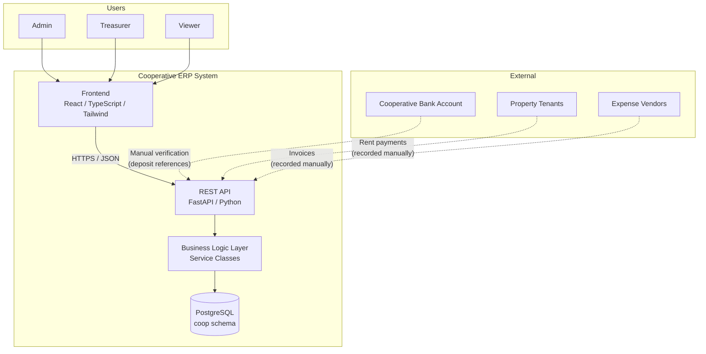

### Layered Architecture

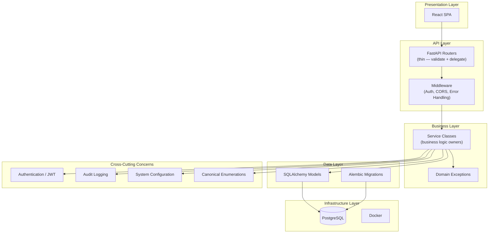

### Technology Stack

| Layer | Technology | Version Constraint |
|---|---|---|
| Frontend | React + TypeScript + Tailwind CSS | React 18+, TS 5+ |
| API | FastAPI | 0.110+ |
| ORM | SQLAlchemy (async) | 2.0+ |
| Database | PostgreSQL | 16+ |
| Migrations | Alembic | 1.13+ |
| Auth | JWT (python-jose) | — |
| Testing | pytest + pytest-asyncio | — |
| Deployment | Docker + Docker Compose | — |

---

## 3. Domain Boundaries

The system is divided into **five bounded contexts** plus a shared core:

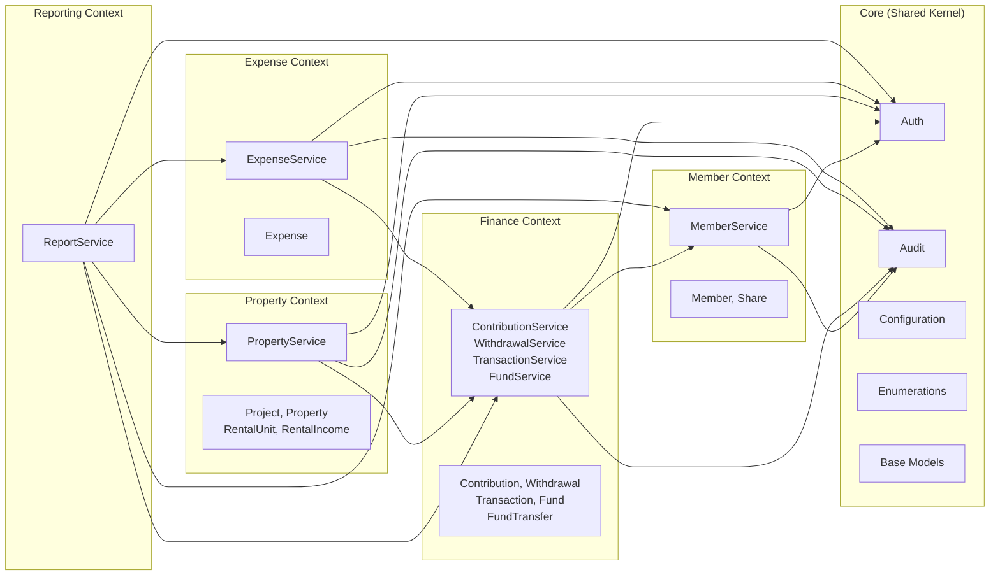

### Boundary Rules

| Rule | Description |
|---|---|
| **Context ownership** | Each context owns its entities exclusively |
| **Cross-context reads** | Contexts may read from other contexts via service calls |
| **Cross-context writes** | Only through the owning context's service |
| **Transaction boundary** | One service method = one database transaction |
| **Financial writes** | All financial mutations flow through `TransactionService.create_transaction()` |
| **No direct model access** | Routers never touch ORM models directly; only through services |

---

## 4. Data Flow

### Contribution Data Flow

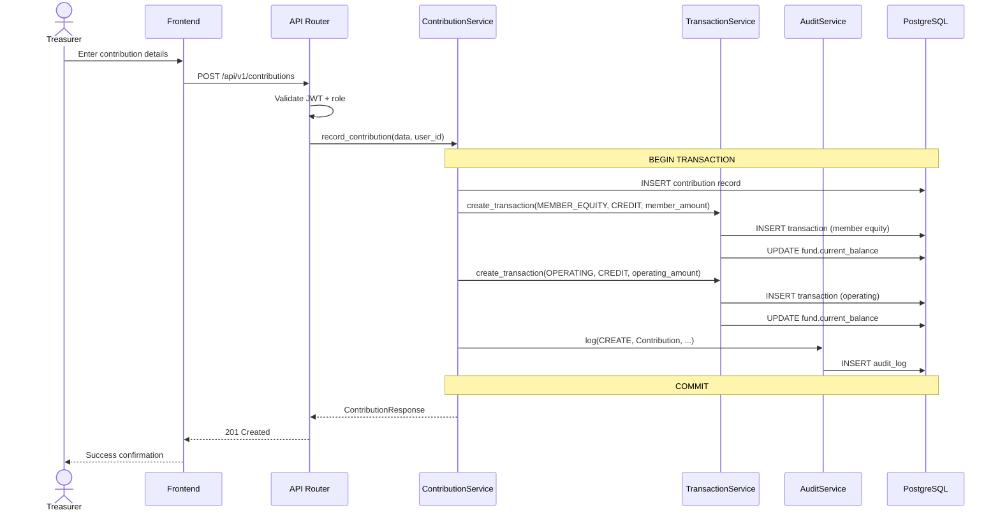

### Member Exit Data Flow

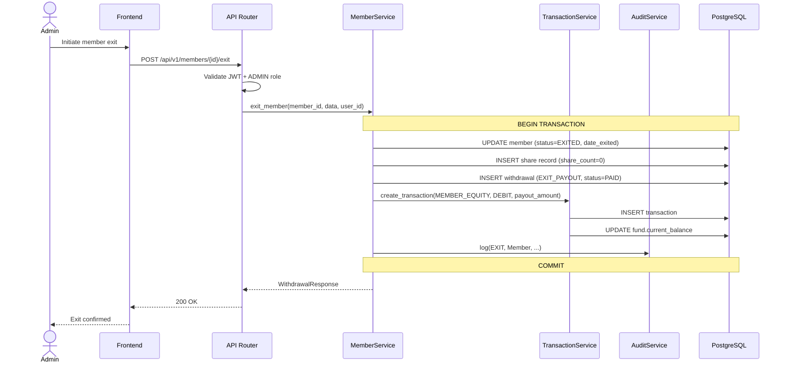

### General Read Flow

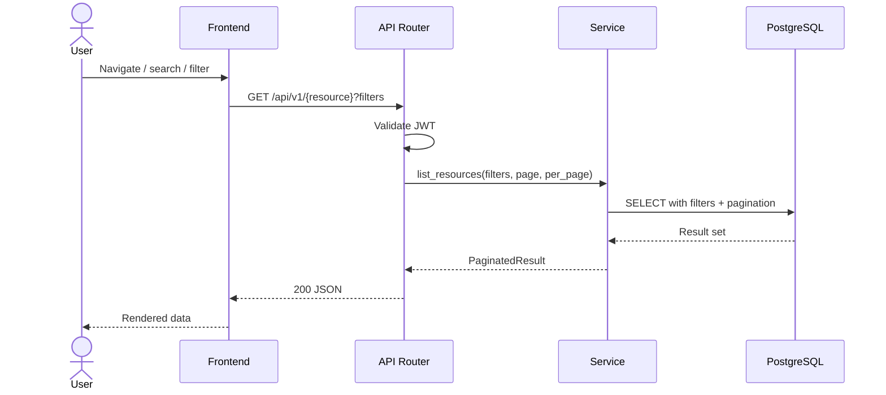

---

## 5. Financial Flow

### Money Movement Map

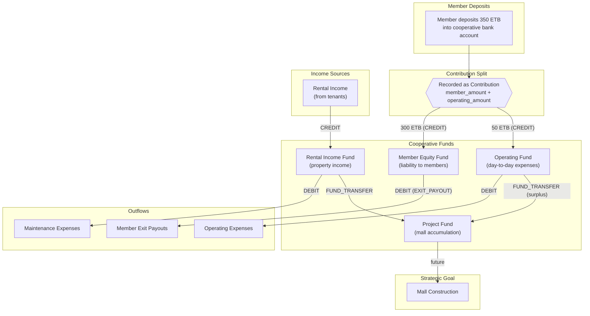

### Fund Relationship Rules

| Fund | Credits From | Debits To | Transfers To |
|---|---|---|---|
| **Member Equity** | Member contributions | Exit payouts, partial withdrawals (UBR-8) | — |
| **Operating** | Operating contributions | Operating expenses | Project Fund |
| **Rental Income** | Tenant rent payments | Property maintenance | Project Fund |
| **Project** | Fund transfers in | Construction expenses | — |
| **Reserve** | Fund transfers in | Emergency expenses | — |

### Financial Transaction Lifecycle

```
Every financial event → creates Transaction record(s) → updates Fund.current_balance

Correction flow:
  Original transaction (immutable)
  → REVERSAL transaction (opposite direction, same amount, reversal_of = original.id)
  → CORRECTION transaction (new correct values)
```

### Balance Calculations

| Balance | Formula |
|---|---|
| **Member accumulated balance** | `SUM(CREDIT txns for member on MEMBER_EQUITY) - SUM(DEBIT txns for member on MEMBER_EQUITY)` |
| **Fund balance (authoritative)** | `SUM(CREDIT txns on fund) - SUM(DEBIT txns on fund)` |
| **Fund balance (cached)** | `fund.current_balance` — denormalized, must reconcile with authoritative |

---

## 6. User Flow

### Primary User Journeys

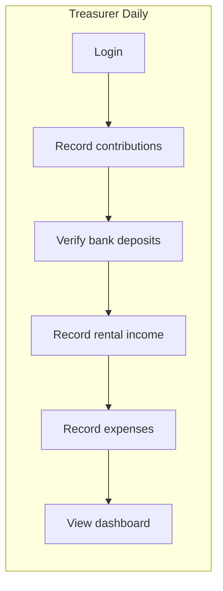

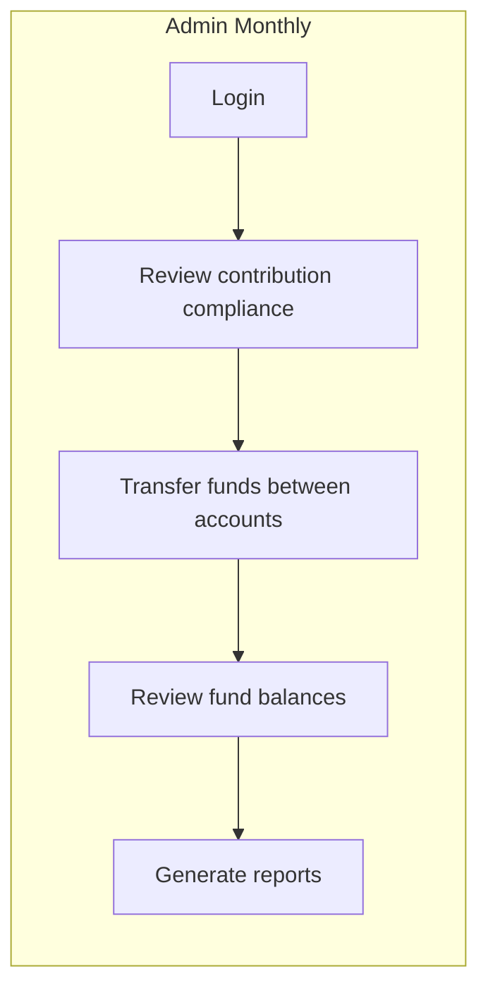

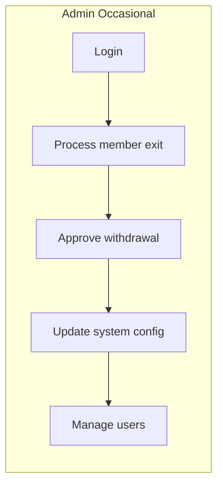

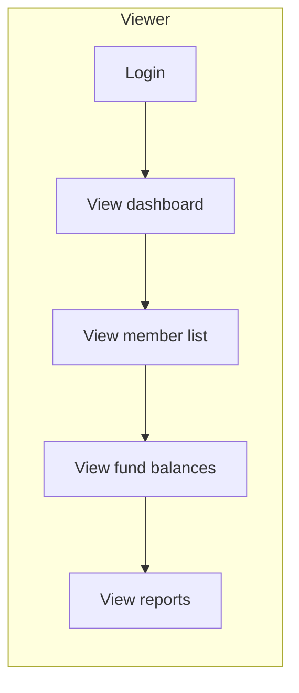

### Page Navigation Map

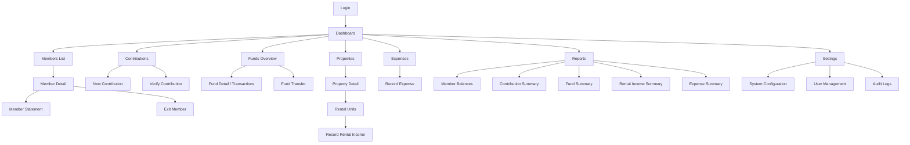

---

## 7. Authentication Flow

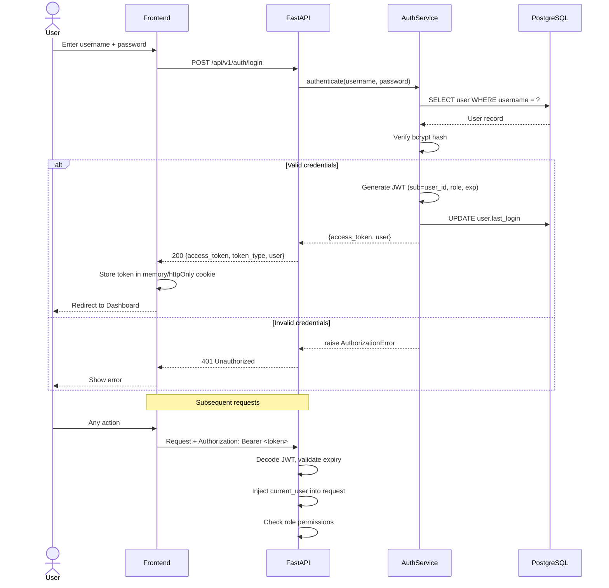

### Token Lifecycle

| Aspect | Value |
|---|---|
| Token type | JWT (JSON Web Token) |
| Algorithm | HS256 |
| Expiry | Configurable (default: 8 hours / 480 min) |
| Storage (frontend) | In-memory or httpOnly cookie (NOT localStorage) |
| Refresh | Re-login required on expiry (no refresh tokens in v1) |

### Password Rules

| Rule | Specification |
|---|---|
| Hashing | bcrypt via passlib |
| Min length | 8 characters (enforced at API) |
| Change flow | Requires current password verification |
| Reset flow | Admin resets to temporary password (v1) |

---

## 8. Authorization Model

### Role-Based Access Control (RBAC)

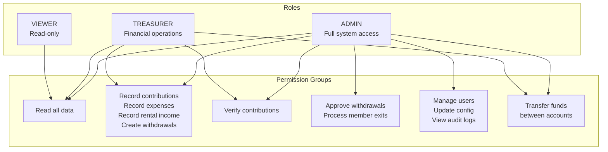

### Authorization Enforcement Points

| Layer | Mechanism |
|---|---|
| **API Router** | FastAPI `Depends()` — validates JWT, extracts role, checks permission |
| **Service Layer** | Services receive `user_id`; services may enforce business-level authorization (e.g., "cannot approve own withdrawal") |
| **Frontend** | UI conditionally renders actions based on role (defense in depth, not primary) |

### Enforcement Implementation Pattern

```
# Router level (FastAPI dependency)
@router.post("/members/{id}/exit")
async def exit_member(
    id: UUID,
    data: MemberExitRequest,
    current_user: User = Depends(require_role(UserRole.ADMIN)),  # ← enforcement
    db: AsyncSession = Depends(get_db),
):
    return await member_service.exit_member(db, id, data, current_user.id)
```

---

## 9. Audit Flow

### What Gets Audited

| Category | Events |
|---|---|
| **Financial Mutations** | Contribution recorded/verified/reversed, withdrawal created/approved/rejected/paid, expense recorded, rental income recorded, fund transfer |
| **Member Lifecycle** | Member created, member updated, member exited |
| **System Administration** | Config changed, user created/deactivated, role changed |
| **Authentication** | Login success, login failure, password changed |

### Audit Flow Diagram

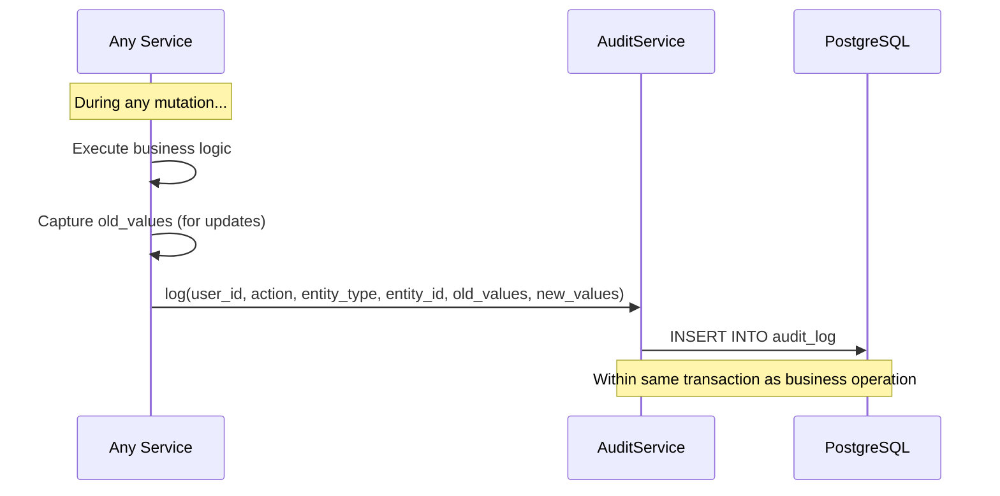

### Audit Record Structure

```
audit_log:
  id          → UUID
  user_id     → who did it
  action      → what they did (CREATE, UPDATE, VERIFY, REVERSE, EXIT, APPROVE, REJECT, LOGIN)
  entity_type → what kind of thing (Member, Contribution, Transaction, SystemConfig, etc.)
  entity_id   → which specific record
  old_values  → JSONB snapshot before (null for creates)
  new_values  → JSONB snapshot after (null for deletes)
  ip_address  → request origin
  created_at  → when
```

### Audit Guarantees

1. Audit log entries are **append-only** — never updated or deleted
2. Audit writes happen **within the same DB transaction** as the business operation — if the business op fails, the audit entry is rolled back too
3. Every financial mutation **MUST** produce an audit entry — this is a service-layer contract

---

## 10. Reporting Flow

### Report Architecture

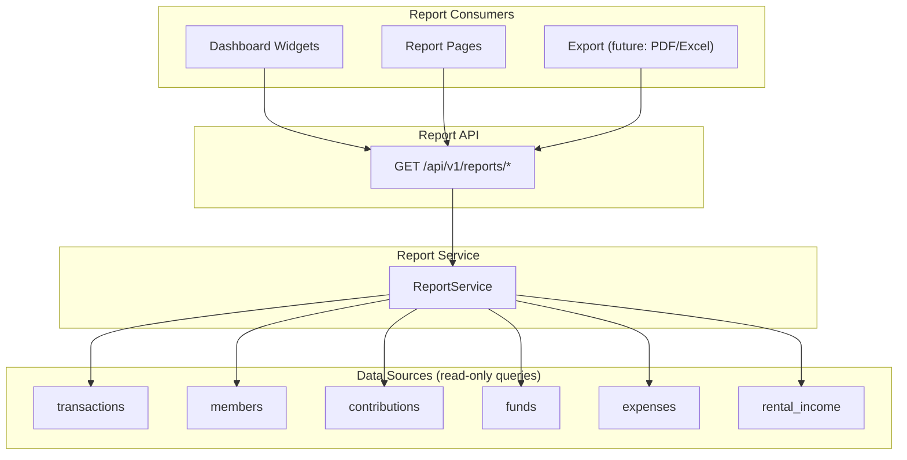

### Available Reports

| Report | Endpoint | Key Aggregation |
|---|---|---|
| **Member Balances** | `GET /reports/member-balances` | Per-member SUM(credits) - SUM(debits) on MEMBER_EQUITY |
| **Contribution Summary** | `GET /reports/contribution-summary` | Per-member contribution totals for a period |
| **Fund Summary** | `GET /reports/fund-summary` | Per-fund income, expenses, net change for a period |
| **Rental Income Summary** | `GET /reports/rental-income-summary` | Per-property, per-unit income for a period |
| **Expense Summary** | `GET /reports/expense-summary` | Per-category expense totals for a period |
| **Member Statement** | `GET /reports/member/{id}/statement` | Chronological transaction list with running balance |

### Report Execution Model

- Reports are **real-time queries** against the transaction tables — no materialized views in v1
- All reports accept optional `from_date` and `to_date` parameters
- Reports are **read-only** — they never mutate data
- Dashboard widgets use the same report endpoints with appropriate filters

---

## 11. Integration Boundaries

### External Systems

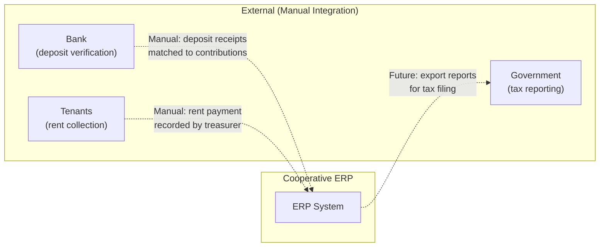

### Integration Boundary Rules

| Boundary | v1 Approach | Future Possibility |
|---|---|---|
| **Bank deposits** | Manual verification by treasurer | Bank API / statement import |
| **Tenant payments** | Manual recording by treasurer | Tenant portal / mobile payment |
| **Tax reporting** | Manual export from reports | Government API integration |
| **Email notifications** | None in v1 | SMTP for contribution reminders |
| **SMS** | None in v1 | SMS gateway for notifications |
| **Document storage** | None in v1 | Object storage for receipts |

### API Boundary

The system exposes a **single REST API** consumed exclusively by the React frontend. There is no public API, no webhooks, and no third-party integrations in v1.

```
Frontend (React) ←→ Backend (FastAPI) ←→ PostgreSQL

No other consumers.
No other producers.
```

---

## 12. Frontend Architecture

### Component Architecture

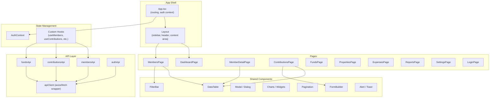

### Frontend Principles

| Principle | Description |
|---|---|
| **Pages are route-level** | One page component per URL route |
| **Components are reusable** | DataTable, FormBuilder, Modal — generic, configurable |
| **API layer is isolated** | All HTTP calls go through typed API modules |
| **Auth state is centralized** | AuthContext provides user/role to all components |
| **Role-based UI rendering** | Components conditionally render actions based on `user.role` |
| **Optimistic reads, confirmed writes** | Reads use cached data; writes always await server confirmation |
| **No local financial computation** | All balance calculations happen server-side |

### Routing Structure

```
/login                    → LoginPage
/                         → DashboardPage
/members                  → MembersPage
/members/:id              → MemberDetailPage
/contributions            → ContributionsPage
/funds                    → FundsPage
/funds/:id                → FundDetailPage
/properties               → PropertiesPage
/properties/:id           → PropertyDetailPage
/expenses                 → ExpensesPage
/reports                  → ReportsPage
/reports/member/:id       → MemberStatementPage
/settings                 → SettingsPage
/settings/users           → UserManagementPage
/settings/audit           → AuditLogPage
```

---

## 13. Backend Architecture

### Request Processing Pipeline

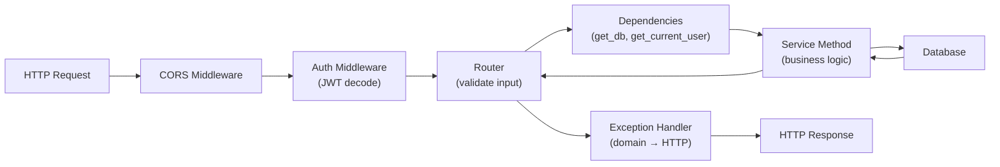

### Backend Layer Responsibilities

| Layer | Responsibility | Does NOT |
|---|---|---|
| **Router** | Request parsing, input validation (Pydantic), role checking, response serialization | Contain business logic |
| **Service** | Business rules, transaction orchestration, domain validation, audit logging | Handle HTTP concerns |
| **Model** | ORM mapping, database constraints, relationships | Contain business logic |
| **Schema** | Request/response data shapes, field validation | Touch the database |
| **Core** | Auth, audit, config, exceptions, enums | Contain domain-specific logic |

### Exception → HTTP Status Mapping

| Domain Exception | HTTP Status | Error Code |
|---|---|---|
| `NotFoundError` | 404 | `NOT_FOUND` |
| `BusinessValidationError` | 400 / 422 | `VALIDATION_ERROR` |
| `AuthorizationError` | 403 | `AUTHORIZATION_ERROR` |
| `ImmutabilityError` | 422 | `IMMUTABILITY_ERROR` |
| `InsufficientFundsError` | 422 | `INSUFFICIENT_FUNDS` |
| `InvalidStateTransitionError` | 422 | `INVALID_STATE_TRANSITION` |
| `DuplicateError` | 409 | `DUPLICATE` |

### API Versioning

- All endpoints prefixed with `/api/v1/`
- Version in URL path (not headers)
- v2 would coexist at `/api/v2/` if needed

---

## 14. Database Architecture

### Schema Design

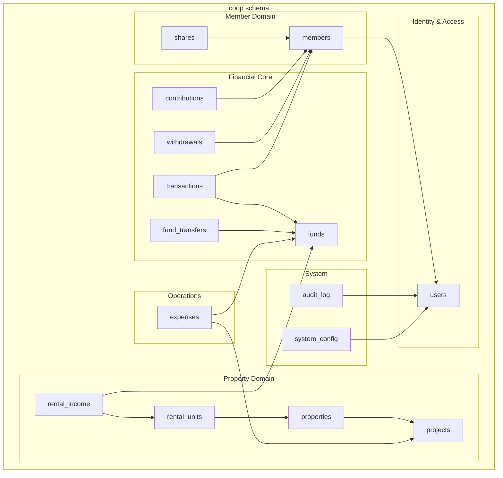

### Database Principles

| Principle | Implementation |
|---|---|
| **Dedicated schema** | All tables in `coop` schema |
| **UUID primary keys** | `gen_random_uuid()` — no sequential leakage |
| **Decimal money** | `NUMERIC(15,2)` for all monetary fields |
| **Timezone-aware timestamps** | `TIMESTAMPTZ` everywhere |
| **No cascading deletes** | Financial tables never cascade |
| **Transaction immutability** | PostgreSQL trigger prevents UPDATE/DELETE on `transactions` |
| **Effective-dated config** | `system_config` uses `effective_from` / `effective_to` |
| **Soft deletes only** | `is_active` flags, never physical deletion |

### Migration Strategy

- **Tool**: Alembic with async SQLAlchemy
- **Naming**: `YYYYMMDD_HHMM_description.py`
- **Rule**: Migrations are forward-only in production
- **Seed data**: Initial funds, config values, and admin user via migration

---

## 15. Infrastructure Architecture

### Development Environment

```mermaid
graph LR
    subgraph "Docker Compose"
        PG["PostgreSQL 16<br/>port: 5432"]
        API["FastAPI (uvicorn)<br/>port: 8000<br/>--reload"]
        FE["React Dev Server<br/>port: 3000"]
    end

    DEV["Developer"] --> FE
    FE --> API
    API --> PG
```

### Container Structure

| Service | Image | Ports | Volumes |
|---|---|---|---|
| `db` | `postgres:16-alpine` | 5432 | Named volume `pgdata` |
| `backend` | Custom (Python 3.11) | 8000 | Bind mount `./backend:/app` |
| `frontend` | Custom (Node 20) | 3000 | Bind mount `./frontend:/app` |

### Production Deployment (Future)

```mermaid
graph TB
    subgraph "Production (future)"
        LB["Reverse Proxy<br/>(nginx / Caddy)"]
        API_PROD["FastAPI<br/>(gunicorn + uvicorn workers)"]
        DB_PROD["PostgreSQL<br/>(managed or dedicated)"]
        STATIC["Static Files<br/>(React build)"]
    end

    CLIENT["Browser"] --> LB
    LB -->|"/api/*"| API_PROD
    LB -->|"/*"| STATIC
    API_PROD --> DB_PROD
```

### Environment Configuration

| Variable | Development | Production |
|---|---|---|
| `DATABASE_URL` | `postgresql+asyncpg://...@localhost:5432/coop_erp` | Managed DB URL |
| `SECRET_KEY` | `change-me-...` | Strong random key |
| `DEBUG` | `true` | `false` |
| `CORS_ORIGINS` | `["http://localhost:3000"]` | `["https://erp.cooperative.example"]` |

---

## 16. Business Rule Classification & Unresolved Decisions

> [!CAUTION]
> Rules in this register are classified into three distinct categories:
> 1. **CONFIRMED BUSINESS REQUIREMENT**: Established cooperative policy that the software must strictly enforce.
> 2. **UNRESOLVED BUSINESS DECISION**: Open legal, governance, financial, or accounting questions that the cooperative has NOT yet decided. Implementation MUST NOT treat proposed software behaviors as approved cooperative policy.
> 3. **PROPOSED TECHNICAL SAFEGUARD**: Software safety mechanisms (e.g., state restrictions, separate tables, disabled flags) created to protect data while business decisions are pending.
>
> For full analysis and chapter-by-chapter blocking details, see: [`docs/OPEN_QUESTIONS.md`](file:///c:/Users/Cyberpunk/Documents/mom_company_erp/docs/OPEN_QUESTIONS.md).

| ID | Rule | Classification | Cooperative Stance vs. Proposed Technical Safeguard |
|---|---|---|---|
| **UBR-1** | Exit payout formula & waiting period | **UNRESOLVED BUSINESS DECISION** | **Confirmed**: Exiting members receive refundable money under applicable rules; shares extinguished; records retained.<br>**Unresolved**: Deduction formulas, shared loss allocations, payout waiting periods.<br>**Safeguard**: Record raw historical balances; payout logic deferred to manual administrative entry until formal policy is adopted. |
| **UBR-2** | Contribution frequency & penalty enforcement | **UNRESOLVED BUSINESS DECISION** | **Confirmed**: Current contribution is ETB 300 (member/project) + ETB 50 (operating).<br>**Unresolved**: Mandatory calendar due dates, grace periods, default penalties.<br>**Safeguard**: Record contributions as deposits occur; do not enforce automated penalties or lockouts in software. |
| **UBR-3** | Individual profit / dividend distribution | **CONFIRMED BUSINESS REQUIREMENT** | **Confirmed**: Profits from cooperative investments and properties belong exclusively to the union. Zero profit/dividends distributed to individual members.<br>**Safeguard**: Ledger schema strictly prohibits credit transactions from rental/investment funds into member equity accounts. |
| **UBR-4** | Voting rights tied to shares | **UNRESOLVED BUSINESS DECISION** | **Unresolved**: One-member-one-vote vs share-weighted voting.<br>**Safeguard**: Excluded entirely from financial ERP scope. |
| **UBR-5** | Loan facility against member equity | **UNRESOLVED BUSINESS DECISION** | **Unresolved**: Whether member equity may collateralize internal loans.<br>**Safeguard**: Excluded entirely from v1 financial schema. |
| **UBR-6** | Multi-currency support | **CONFIRMED BUSINESS REQUIREMENT** | **Confirmed**: All financial accounts, shares, and contributions operate strictly in Ethiopian Birr (ETB).<br>**Safeguard**: Single currency (ETB) enforced across ledger; currency code field preserved in config for future extensibility without conversion logic. |
| **UBR-7** | Interest accrual on member balances | **CONFIRMED BUSINESS REQUIREMENT** | **Confirmed**: Member contribution balances do not accrue interest. The cooperative is not a commercial bank.<br>**Safeguard**: Zero interest accrual logic or transactions exist in the ledger engine. |
| **UBR-8** | Partial withdrawal without exiting | **UNRESOLVED BUSINESS DECISION** | **Unresolved**: Whether active members may withdraw accumulated contributions without exiting.<br>**Safeguard**: Model schema supports it, but feature is disabled by default via `PARTIAL_WITHDRAWAL_ALLOWED = false` config flag. |
| **UBR-9** | Bank reconciliation & deposit verification workflow | **UNRESOLVED BUSINESS DECISION** | **Confirmed**: Members deposit directly into cooperative bank accounts.<br>**Unresolved**: Formal multi-tier verification process, approval chains, reconciliation timeframe.<br>**Safeguard**: Two-stage workflow (`RECORDED` → `VERIFIED`) requiring manual cross-referencing with bank slips by authorized treasurer/admin. |
| **UBR-10** | Fiscal year definition | **UNRESOLVED BUSINESS DECISION** | **Unresolved**: Gregorian calendar year vs Ethiopian fiscal year (Hamle 1 - Sene 30).<br>**Safeguard**: Store ISO timestamps; parameterize reporting queries with explicit date ranges (`start_date`, `end_date`) to remain fiscal-year agnostic. |
| **UBR-11** | SUSPENDED member status | **UNRESOLVED BUSINESS DECISION** | **Unresolved**: Grounds for suspension, impact on ongoing contribution duties, and access rights.<br>**Safeguard**: Enum includes `SUSPENDED` value for future compatibility, but zero automated transition workflows or business logic are attached to it. |
| **UBR-12** | Maximum contribution limits | **UNRESOLVED BUSINESS DECISION** | **Unresolved**: Whether members may voluntarily contribute above ETB 300/50, and surplus classification.<br>**Safeguard**: Validate member vs operating split but enforce no arbitrary contribution ceilings in software. |
| **UBR-13** | Approval workflow for expenses | **UNRESOLVED BUSINESS DECISION** | **Unresolved**: Tiered expenditure authorization thresholds (e.g. board sign-off above specific amounts).<br>**Safeguard**: Direct recording by `ADMIN` or `TREASURER` with mandatory receipt reference and fund specification; tiered multi-signature workflows deferred. |
| **UBR-14** | Share capital vs. recurring contribution relationship | **UNRESOLVED BUSINESS DECISION** | **Confirmed**: 12 shares @ ETB 5,000 = ETB 60,000; recurring contribution is ETB 300 + ETB 50.<br>**Unresolved**: Whether initial ETB 60,000 share balance is merged into recurring contribution balances or held as distinct equity with different exit rules.<br>**Safeguard**: Maintain `coop.shares` and `coop.contributions` as strictly distinct tables and separate ledger streams; do not implement automated opening-balance merging, cumulative balance calculations, or combined payout workflows until formally resolved by the cooperative. |
| **UBR-15** | Historical opening balance ledger cut-off & import protocol | **UNRESOLVED BUSINESS DECISION** | **Confirmed**: ~150 founding members have historical records.<br>**Unresolved**: Authoritative cut-off date and method (lump-sum vs retroactive) for importing opening balances into the immutable ledger.<br>**Safeguard**: No automated opening-balance import scripts or ledger seeding are implemented in software; schema supports `OPENING_BALANCE` transaction type when authoritative cut-off figures are formally approved. |
| **UBR-16** | Direct bank deposit verification & unidentified inflows | **UNRESOLVED BUSINESS DECISION** | **Confirmed**: Members deposit directly into bank accounts.<br>**Unresolved**: Accounting policy and timeframe for identifying unreferenced bank deposits.<br>**Safeguard**: Unidentified bank inflows are never automatically assigned to any member; manual cross-referencing with physical slips is mandatory before verifying. |
| **UBR-17** | Exited member historical retention & re-admission policy | **UNRESOLVED BUSINESS DECISION** | **Confirmed**: Members can leave, have shares extinguished, receive refundable money under applicable rules, and historical records must remain available.<br>**Unresolved**: Whether exit is permanently irreversible by cooperative policy, or whether an exited member could later be readmitted if membership reopens.<br>**Safeguard**: In the v1 software state machine, member exit transition `ACTIVE` → `EXITED` is strictly one-way without automated reactivation routes. Historical records are preserved permanently (never deleted). This technical constraint is a safeguard to prevent accidental reactivation and must NOT be misconstrued as an approved cooperative policy prohibiting readmission. |
| **UBR-18** | Rental income allocation, mall project funding & reserve fund | **UNRESOLVED BUSINESS DECISION** *(with Confirmed Intent)* | **Confirmed**: Investment profits do not belong to individual members. Cooperative income supports normal union expenses, and remaining rental-project income is intended for the mall project.<br>**Unresolved**: Whether a formal statutory "Reserve Fund" is required by bylaws, and the exact formula/split for allocating rental income between expenses and project capital.<br>**Safeguard**: Isolate rental earnings from member equity ledgers. Store rental income in dedicated cooperative accounts without distributing dividends to members. Fund allocation ratios between operating expenses and project construction remain configurable rather than hardcoded in application logic. |

---

## 17. Architectural Risks

| # | Risk | Severity | Mitigation |
|---|---|---|---|
| **AR-1** | `fund.current_balance` desynchronizes from transaction sum | **HIGH** | Reconciliation endpoint; periodic automated check; balance computed from transactions is authoritative |
| **AR-2** | No backup/restore strategy in v1 | **HIGH** | Docker volume persistence; manual `pg_dump` until automated backups |
| **AR-3** | JWT secret key management | **MEDIUM** | Environment variable; rotate via deployment; no embedded secrets |
| **AR-4** | Single admin creates single point of failure for approvals | **MEDIUM** | Create at least 2 admin users; consider adding BOARD_MEMBER role |
| **AR-5** | No rate limiting on API | **LOW** | Acceptable for 150 users on private network; add if exposed publicly |
| **AR-6** | Reports may become slow at scale | **LOW** | Acceptable for ~150 members; add materialized views / caching if needed |
| **AR-7** | No email/SMS notifications | **LOW** | Manual communication for v1; integration boundary is defined for future |
| **AR-8** | Browser token storage vulnerability | **MEDIUM** | Use httpOnly cookies or in-memory storage; never localStorage |
| **AR-9** | No data export/import mechanism | **MEDIUM** | Needed for initial data migration; build CSV import as part of Phase 2 |
| **AR-10** | Immutability trigger prevents legitimate schema migrations | **LOW** | Temporarily disable trigger during migrations; document the process |

---

## 18. Configurable Decisions

These values MUST remain configurable through `system_config` with effective dating. They MUST NOT be hardcoded anywhere in the application.

| Config Key | Current Value | Type | Why Configurable |
|---|---|---|---|
| `SHARE_VALUE` | 5,000.00 ETB | DECIMAL | May change by cooperative vote |
| `SHARES_PER_MEMBER` | 12 | INTEGER | May change by cooperative vote |
| `MEMBER_CONTRIBUTION_AMOUNT` | 300.00 ETB | DECIMAL | May change by cooperative decision |
| `OPERATING_CONTRIBUTION_AMOUNT` | 50.00 ETB | DECIMAL | May change by cooperative decision |
| `COOPERATIVE_NAME` | Mom Company Cooperative Union | STRING | Display purposes |
| `CURRENCY_CODE` | ETB | STRING | Future multi-currency support |
| `MEMBERSHIP_OPEN` | false | BOOLEAN | Currently closed; may reopen |
| `PARTIAL_WITHDRAWAL_ALLOWED` | false | BOOLEAN | UBR-8 — decision pending |
| `JWT_EXPIRATION_MINUTES` | 480 | INTEGER | Security tuning |

### Effective Dating Rule

```
Changing a config value:
  1. Close current record: SET effective_to = new_effective_from - 1 day
  2. Create new record: effective_from = specified date, effective_to = NULL

Querying config:
  - Current value: WHERE config_key = ? AND effective_to IS NULL
  - Historical value: WHERE config_key = ? AND effective_from <= ? AND (effective_to IS NULL OR effective_to >= ?)
```

---

## 19. Modular Monolith & Architectural Evolution

The Cooperative Financial Management ERP is architected to evolve as a **modular monolith**: one cohesive application with clearly separated business modules, explicit interfaces, and shared platform services.

### Core Architecture Principles

1. **Clear Module Boundaries**: Business domains own their responsibilities exclusively. Cross-module collaboration must use appropriate public service interfaces rather than reach directly into another module's private implementation or internal ORM models.
2. **Shared Platform Capabilities**: Common platform concerns—authentication and authorization, API routing conventions, system configuration, common schemas and utilities, audit logging, centralized error handling, and testing conventions—must be reused consistently across modules rather than reinvented in each domain.
3. **Controlled Extensibility**: Future modules must have a clear, approved mechanism to expose services, routes, UI screens, navigation entries, and RBAC permissions. These integration mechanisms must be introduced incrementally when justified by concrete use cases.
4. **One Authoritative Financial Source of Truth**: Analytical tools, reporting engines, and dashboards must never create competing financial ledgers or independently maintained balances. All financial calculations and mutations must flow through validated business services and the immutable transaction ledger.
5. **Presentation/Business Separation**: User interfaces, themes, configurable dashboards, member-profile layouts, and administrative tools must remain strictly decoupled from business logic and must never bypass backend validation, authorization checks, or data-access controls.
6. **Controlled Change**: Database modifications require versioned, reproducible Alembic migrations. All new functionality must satisfy established quality gates, mandatory audit logging requirements, and automated test coverage.
7. **Secure Maintenance**: Operational maintenance and security tooling may scan dependencies, recommend patches, execute test suites, and prepare reviewed changes. Unrestricted automatic modification or autonomous deployment to production is explicitly not an architectural goal.

### Future Capabilities vs. Current State

The following systems represent planned future capabilities, not existing implementations:
- **Financial Intelligence & Cash-Flow Analysis**: Predictive reporting and liquidity trends built atop the core ledger.
- **Security Center**: Enhanced audit monitoring, automated credential anomaly detection, and compliance reporting.
- **Configurable Member Workspaces**: Role-tailored dashboards and dynamic layouts.
- **Workflow Automation**: Configurable notification triggers and multi-step approval pipelines.
- **Reusable Visual Components**: Extended UI component libraries for domain visualizations.
- **Optional Feature Modules**: Additional cooperative services introduced incrementally without destabilizing core financial engines.

### Architectural Non-Goals

To maintain system integrity and avoid speculative complexity, the following are explicit non-goals:
- **No generic plugin marketplace**: The system will not build runtime dynamic plugin loaders or untrusted extension registries.
- **No universal workflow engine**: Business rules and state transitions remain explicit and code-defined rather than delegated to arbitrary BPMN/workflow engines.
- **No visual layout editor**: UI layout remains structured code adhering to the design system.
- **No microservice fleet**: The architecture remains a single cohesive deployable unit (modular monolith) to avoid distributed transaction overhead, eventual consistency complexities, and multi-network failure modes.
- **No broad feature-flag framework**: Configuration uses effective-dated `system_config` values for specific business decisions, not speculative runtime feature toggling.

---

## Document Cross-References

| Document | Path | Purpose |
|---|---|---|
| Implementation Plan | `docs/implementation_plan.md` | Phases, timeline, verification |
| Domain Model | `docs/domain_model.md` | Entity specs, relationships, enums |
| Database Schema | `docs/database_schema.md` | DDL, constraints, indexes |
| API Contract | `docs/api_contract.md` | REST endpoints, auth matrix |
| Service Contracts | `docs/service_contracts.md` | Method signatures, invariants |
| Open Questions Register | `docs/OPEN_QUESTIONS.md` | Business rule classifications, open decisions & safeguards |
| Module Map | `MODULE_MAP.md` (project root) | Module definitions, dependencies |
