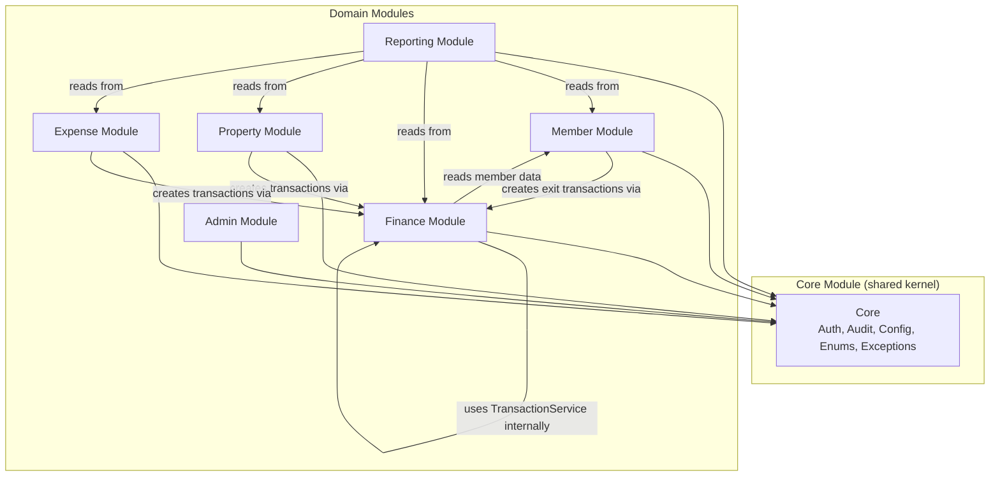
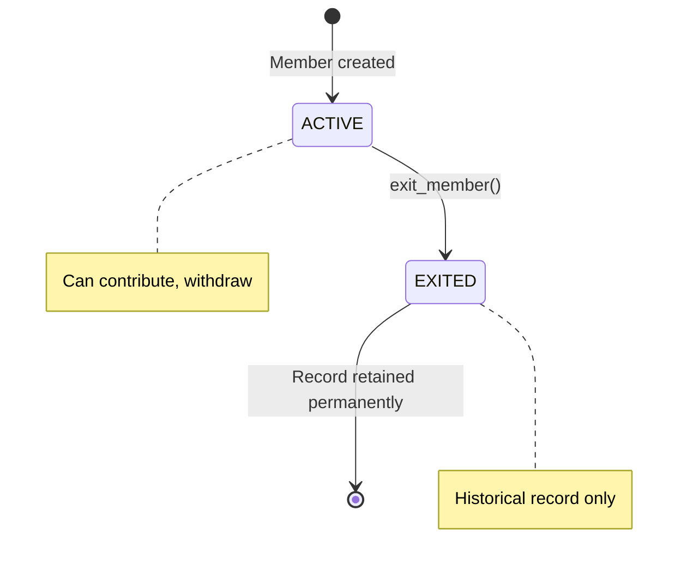
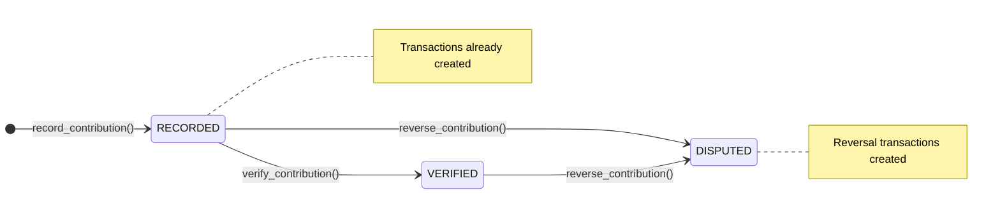
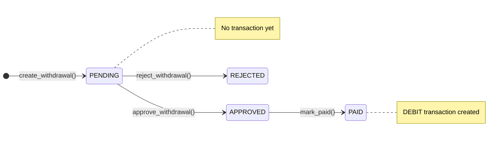
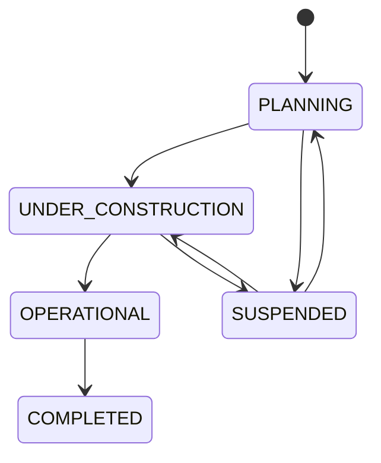
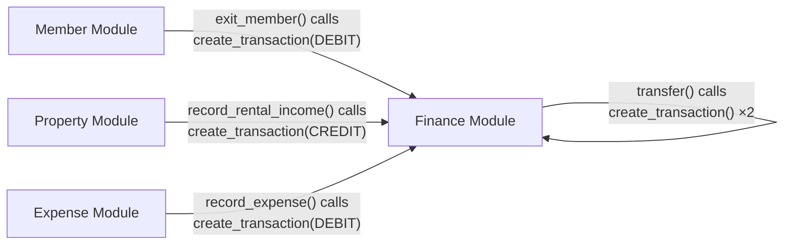
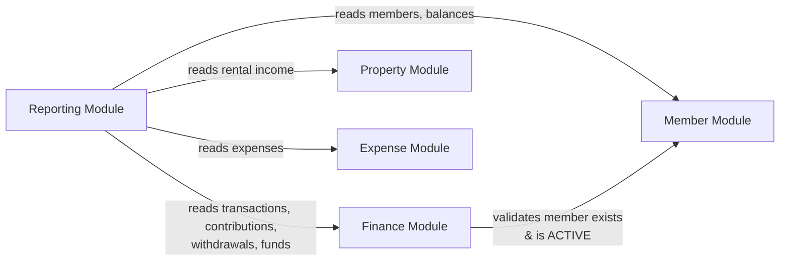

# MODULE_MAP.md — Cooperative Financial Management ERP

> **Document Status**: Module Definitions — Source of Truth  
> **Last Updated**: 2026-09-05  
> **Companion to**: [ARCHITECTURE.md](file:///c:/Users/Cyberpunk/Documents/mom_company_erp/ARCHITECTURE.md)

---

## Module Dependency Graph



### Dependency Rules

| Rule | Description |
|---|---|
| **Core is dependency-free** | Core depends on nothing except Python stdlib and framework |
| **Domain modules depend on Core** | Every domain module imports from Core |
| **Finance is the financial gateway** | All transaction creation flows through Finance module's `TransactionService` |
| **Reporting is read-only** | Reporting reads from all modules but writes to none |
| **No circular dependencies** | Module A → Module B does NOT allow Module B → Module A |
| **Member ↔ Finance exception** | Member exit creates transactions (Member → Finance); contributions reference members (Finance → Member reads). This is managed through service composition, not circular imports |

---

## Module 1: Core Module

### Purpose
Provide shared infrastructure, cross-cutting concerns, and canonical definitions used by all domain modules.

### Responsibilities
- Authentication (JWT generation, validation, password hashing)
- Authorization (role checking, permission enforcement)
- Audit logging (append-only event recording)
- System configuration (effective-dated key-value store)
- Canonical enumerations (single source of truth for all status/type values)
- Domain exception hierarchy
- Base ORM model with standard audit columns
- Pagination utilities
- Monetary value utilities (decimal rounding, formatting)

### Inputs
- JWT tokens (for validation)
- Username/password (for authentication)
- Configuration keys (for lookup)
- Audit event data (from calling services)

### Outputs
- Authenticated user context (user_id, role)
- Configuration values (current or historical)
- Audit log entries (persisted)
- Standardized error responses

### Dependencies
- None (leaf module)

### Entities Involved
- `User`
- `AuditLog`
- `SystemConfig`

### APIs Involved
| Endpoint | Method | Description |
|---|---|---|
| `/api/v1/auth/login` | POST | Authenticate user, return JWT |
| `/api/v1/auth/me` | GET | Current user profile |
| `/api/v1/auth/change-password` | POST | Change password |
| `/api/v1/config` | GET | All current config values |
| `/api/v1/config/{key}` | GET | Config value + history |
| `/api/v1/config/{key}` | PUT | Update config (ADMIN) |
| `/api/v1/audit-logs` | GET | Query audit logs (ADMIN) |

### UI Involved
- Login page
- Settings → System Configuration
- Settings → Audit Logs

### Backend Files
```
app/core/
├── __init__.py
├── security.py          # JWT, password hashing, token generation
├── dependencies.py      # FastAPI Depends: get_db, get_current_user, require_role
├── exceptions.py        # Domain exception hierarchy
├── enums.py             # All enumerations (IMPLEMENTED)
├── audit.py             # AuditService class
└── pagination.py        # PaginatedResult, pagination helpers

app/models/
├── base.py              # CoopBase declarative base
├── user.py              # User model
├── audit_log.py         # AuditLog model
└── system_config.py     # SystemConfig model

app/schemas/
├── auth.py              # LoginRequest, LoginResponse, TokenPayload
├── user.py              # UserCreate, UserUpdate, UserResponse
└── config.py            # ConfigValue, ConfigUpdate, ConfigHistory

app/services/
├── auth_service.py      # authenticate, create_token, verify_password
└── config_service.py    # get_current_config, get_config_value, update_config

app/api/v1/
├── auth.py              # Auth router
└── config.py            # Config router

app/utils/
└── money.py             # Decimal rounding, formatting (PARTIALLY IMPLEMENTED)
```

---

## Module 2: Member Module

### Purpose
Manage the lifecycle of cooperative members, from registration through exit, including share ownership tracking.

### Responsibilities
- Member registration (data migration + future reopening)
- Member profile management (name, contact, notes)
- Share ownership tracking (append-only share records)
- Member exit processing (status change, share zeroing, payout trigger)
- Member balance calculation (derived from transactions)
- Member search and listing

### Inputs
- Member registration data (name, number, contact, join date)
- Member profile updates (name, phone, email, address, notes)
- Member exit request (exit date, reason, payout amount)

### Outputs
- Member summary (basic info + current shares + balance)
- Member detail (full info + shares + recent contributions + balance breakdown)
- Member balance (decimal amount)
- Exit confirmation (withdrawal record)

### Dependencies
- **Core Module** — auth, audit, config, enums, exceptions
- **Finance Module** — `TransactionService.create_transaction()` for exit payouts

### Entities Involved
- `Member` — core member record
- `Share` — share ownership records (append-only)
- `Withdrawal` — created as part of exit flow (EXIT_PAYOUT)
- `Transaction` — created as part of exit flow (DEBIT on member equity)
- `Fund` — member equity fund balance updated on exit

### APIs Involved
| Endpoint | Method | Roles | Description |
|---|---|---|---|
| `/api/v1/members` | GET | ALL | List members (paginated, filterable) |
| `/api/v1/members/{id}` | GET | ALL | Member detail with balance |
| `/api/v1/members` | POST | ADMIN | Create member |
| `/api/v1/members/{id}` | PATCH | ADMIN | Update member profile |
| `/api/v1/members/{id}/exit` | POST | ADMIN | Process member exit |

### UI Involved
- Members list page (table with search, status filter)
- Member detail page (profile, shares, contributions, balance)
- New member form (modal or page)
- Edit member form (modal)
- Exit member confirmation dialog

### State Machine



---

## Module 3: Finance Module

### Purpose
Manage all financial operations: contributions, withdrawals, fund accounting, transactions, and fund transfers. This is the financial core of the system.

### Responsibilities
- **Contributions**: Record, verify, and reverse member contributions
- **Withdrawals**: Create, approve, reject, and pay withdrawal requests
- **Transactions**: Create immutable ledger entries (INTERNAL — not directly exposed)
- **Funds**: Manage fund balances, transfers, and reconciliation
- **Balance integrity**: Ensure fund.current_balance stays synchronized with transaction sum

### Inputs
- Contribution data (member, amounts, date, bank reference)
- Withdrawal requests (member, amount, type)
- Fund transfer requests (source, destination, amount)
- Verification confirmations
- Approval/rejection decisions

### Outputs
- Contribution records with status
- Withdrawal records with status
- Transaction records (immutable ledger entries)
- Fund balances (current + historical)
- Reconciliation results

### Dependencies
- **Core Module** — auth, audit, config, enums, exceptions
- **Member Module** — reads member data for validation (member exists, is active)

### Entities Involved
- `Contribution` — member deposit records
- `Withdrawal` — payout request records
- `Transaction` — immutable financial ledger (**central entity**)
- `Fund` — fund accounts with cached balance
- `FundTransfer` — inter-fund movement records

### APIs Involved
| Endpoint | Method | Roles | Description |
|---|---|---|---|
| `/api/v1/contributions` | GET | ALL | List contributions |
| `/api/v1/contributions` | POST | ADMIN, TREASURER | Record contribution |
| `/api/v1/contributions/{id}/verify` | POST | ADMIN, TREASURER | Verify against bank |
| `/api/v1/contributions/{id}/reverse` | POST | ADMIN, TREASURER | Reverse contribution |
| `/api/v1/withdrawals` | GET | ALL | List withdrawals |
| `/api/v1/withdrawals` | POST | ADMIN, TREASURER | Create withdrawal request |
| `/api/v1/withdrawals/{id}/approve` | POST | ADMIN | Approve withdrawal |
| `/api/v1/withdrawals/{id}/reject` | POST | ADMIN | Reject withdrawal |
| `/api/v1/withdrawals/{id}/mark-paid` | POST | ADMIN, TREASURER | Mark as paid (creates transaction) |
| `/api/v1/transactions` | GET | ALL | List transactions (read-only) |
| `/api/v1/transactions/{id}` | GET | ALL | Transaction detail |
| `/api/v1/funds` | GET | ALL | List all funds |
| `/api/v1/funds/{id}` | GET | ALL | Fund detail |
| `/api/v1/funds/{id}/transactions` | GET | ALL | Fund transaction history |
| `/api/v1/funds/transfer` | POST | ADMIN, TREASURER | Transfer between funds |

### UI Involved
- Contributions list page (table with filters: member, status, period)
- New contribution form
- Contribution verification workflow
- Withdrawals list page
- Withdrawal approval workflow
- Funds overview page (cards with balances)
- Fund detail page (transaction list)
- Fund transfer form

### State Machines





### Transaction Flow Rules

```
Contribution recording:
  → 1 CREDIT transaction on MEMBER_EQUITY fund (member_amount)
  → 1 CREDIT transaction on OPERATING fund (operating_amount)
  → Both in same DB transaction (atomic)

Contribution reversal:
  → 1 REVERSAL (DEBIT) on MEMBER_EQUITY fund
  → 1 REVERSAL (DEBIT) on OPERATING fund
  → reversal_of = original transaction IDs

Withdrawal payment:
  → 1 DEBIT transaction on MEMBER_EQUITY fund
  → Only on mark_paid, NOT on create or approve

Fund transfer:
  → 1 FUND_TRANSFER_OUT (DEBIT) on source fund
  → 1 FUND_TRANSFER_IN (CREDIT) on destination fund
  → Atomic
```

---

## Module 4: Property Module

### Purpose
Manage cooperative investment properties, rental units, tenants, and rental income recording.

### Responsibilities
- Project tracking (planning through completion)
- Property management (buildings/locations)
- Rental unit management (individual shops/spaces)
- Tenant tracking (name, lease dates, rent amount)
- Rental income recording (creates transaction on rental income fund)

### Inputs
- Project data (name, status, budget, dates)
- Property data (name, type, address)
- Rental unit data (identifier, tenant, rent amount, lease dates)
- Rental income data (unit, amount, date, period)

### Outputs
- Project listings and details
- Property and unit listings
- Rental income records
- Income by property/unit aggregations

### Dependencies
- **Core Module** — auth, audit, enums, exceptions
- **Finance Module** — `TransactionService.create_transaction()` for rental income

### Entities Involved
- `Project` — investment project (e.g., "Rental Shops Phase 1")
- `Property` — physical property (e.g., "Commercial Block A")
- `RentalUnit` — individual rentable space (e.g., "Shop 1")
- `RentalIncome` — income event record
- `Transaction` — created when rental income is recorded
- `Fund` — rental income fund credited

### APIs Involved
| Endpoint | Method | Roles | Description |
|---|---|---|---|
| `/api/v1/projects` | GET | ALL | List projects |
| `/api/v1/projects/{id}` | GET | ALL | Project detail |
| `/api/v1/projects` | POST | ADMIN, TREASURER | Create project |
| `/api/v1/projects/{id}` | PATCH | ADMIN, TREASURER | Update project |
| `/api/v1/properties` | GET | ALL | List properties |
| `/api/v1/properties/{id}` | GET | ALL | Property detail |
| `/api/v1/properties` | POST | ADMIN, TREASURER | Create property |
| `/api/v1/properties/{id}` | PATCH | ADMIN, TREASURER | Update property |
| `/api/v1/properties/{pid}/units` | GET | ALL | List units in property |
| `/api/v1/units/{id}` | GET | ALL | Unit detail |
| `/api/v1/properties/{pid}/units` | POST | ADMIN, TREASURER | Create unit |
| `/api/v1/units/{id}` | PATCH | ADMIN, TREASURER | Update unit |
| `/api/v1/rental-income` | GET | ALL | List rental income |
| `/api/v1/rental-income` | POST | ADMIN, TREASURER | Record rental income |

### UI Involved
- Projects list page
- Project detail page
- Properties list page (filterable by project)
- Property detail with units table
- Rental unit management (add/edit unit, tenant info)
- Record rental income form
- Rental income history table

### State Machine (Project)



---

## Module 5: Expense Module

### Purpose
Record and categorize cooperative expenses, creating the corresponding financial transactions.

### Responsibilities
- Expense recording with categorization
- Linking expenses to specific funds (operating, rental income, project)
- Linking expenses to projects (optional)
- Expense listing and filtering

### Inputs
- Expense data (fund, category, description, amount, date, vendor, receipt reference)
- Optional project association

### Outputs
- Expense records
- Expense summaries by category, fund, project, period

### Dependencies
- **Core Module** — auth, audit, enums, exceptions
- **Finance Module** — `TransactionService.create_transaction()` for expense debits

### Entities Involved
- `Expense` — expense event record
- `Transaction` — DEBIT transaction created when expense is recorded
- `Fund` — specified fund debited
- `Project` — optional association

### APIs Involved
| Endpoint | Method | Roles | Description |
|---|---|---|---|
| `/api/v1/expenses` | GET | ALL | List expenses (filterable) |
| `/api/v1/expenses` | POST | ADMIN, TREASURER | Record expense |

### UI Involved
- Expenses list page (table with filters: fund, category, date range, project)
- Record expense form (fund selection, category, amount, vendor, receipt)

### Expense Categories
```
ADMINISTRATIVE | MAINTENANCE | UTILITIES | SALARY | TAX | LEGAL | CONSTRUCTION | OTHER
```

---

## Module 6: Reporting Module

### Purpose
Provide read-only aggregated views of cooperative financial data for decision-making, compliance monitoring, and member statements.

### Responsibilities
- Member balance reporting (all members, accumulated balances)
- Contribution compliance monitoring (who contributed, who didn't, per period)
- Fund financial summaries (income, expenses, net change per period)
- Rental income summaries (by property, by unit, by period)
- Expense summaries (by category, by fund, by period)
- Member statements (individual transaction history with running balance)
- Dashboard metrics (key financial indicators)

### Inputs
- Date range filters (from_date, to_date)
- Period filters (e.g., "2026-09")
- Member filter (for member-specific reports)
- Fund filter (for fund-specific reports)

### Outputs
- Tabular report data (JSON, rendered as tables in frontend)
- Summary statistics (totals, counts, averages)
- Dashboard widget data (fund balances, recent activity, compliance %)

### Dependencies
- **Core Module** — auth, enums
- **Member Module** — member data (read)
- **Finance Module** — transaction, contribution, withdrawal, fund data (read)
- **Property Module** — rental income data (read)
- **Expense Module** — expense data (read)

### Entities Involved
- Reads from ALL financial entities (transactions, contributions, withdrawals, funds, rental_income, expenses, members)
- Creates NO entities

### APIs Involved
| Endpoint | Method | Roles | Description |
|---|---|---|---|
| `/api/v1/reports/member-balances` | GET | ALL | All member balances |
| `/api/v1/reports/contribution-summary` | GET | ALL | Contribution totals by member/period |
| `/api/v1/reports/fund-summary` | GET | ALL | Fund income/expense/net by period |
| `/api/v1/reports/rental-income-summary` | GET | ALL | Rental income by property/unit |
| `/api/v1/reports/expense-summary` | GET | ALL | Expenses by category/fund |
| `/api/v1/reports/member/{id}/statement` | GET | ALL | Member transaction history |

### UI Involved
- Reports landing page (report selector)
- Member balances report page
- Contribution summary report page
- Fund summary report page
- Rental income summary report page
- Expense summary report page
- Member statement page (printable)
- Dashboard widgets (balance cards, charts, recent activity)

---

## Module 7: Admin Module

### Purpose
System administration including user management, access control, and system health monitoring.

### Responsibilities
- User CRUD (create, read, update, deactivate — never delete)
- Role assignment
- Password management (admin reset, self-service change)
- Audit log viewing
- Fund reconciliation checks

### Inputs
- User management data (username, email, full_name, role)
- Password reset requests
- Reconciliation trigger

### Outputs
- User listings
- Audit log entries (paginated, filterable)
- Reconciliation results (expected vs actual fund balances)

### Dependencies
- **Core Module** — auth, audit, enums, exceptions
- **Finance Module** — `FundService.reconcile_fund()` for balance checks

### Entities Involved
- `User` — system user accounts
- `AuditLog` — event log
- `Fund` — for reconciliation

### APIs Involved
| Endpoint | Method | Roles | Description |
|---|---|---|---|
| `/api/v1/users` | GET | ADMIN | List users |
| `/api/v1/users` | POST | ADMIN | Create user |
| `/api/v1/users/{id}` | PATCH | ADMIN | Update user |
| `/api/v1/users/{id}/deactivate` | POST | ADMIN | Deactivate user |
| `/api/v1/audit-logs` | GET | ADMIN | Query audit logs |

### UI Involved
- User management page (table + create/edit forms)
- Audit log viewer (searchable, filterable table)
- System health / reconciliation page

---

## Module Interaction Summary

### Write Interactions (who calls whom for writes)



### Read Interactions (who reads from whom)



---

## File Mapping: Module → Backend Files

| Module | Models | Schemas | Services | API Routers |
|---|---|---|---|---|
| **Core** | `user.py`, `audit_log.py`, `system_config.py`, `base.py` | `auth.py`, `user.py`, `config.py` | `auth_service.py`, `config_service.py` | `auth.py`, `config.py` |
| **Member** | `member.py`, `share.py` | `member.py` | `member_service.py` | `members.py` |
| **Finance** | `contribution.py`, `withdrawal.py`, `transaction.py`, `fund.py`, `bank_account.py` | `contribution.py`, `withdrawal.py`, `transaction.py`, `fund.py` | `contribution_service.py`, `withdrawal_service.py`, `transaction_service.py`, `fund_service.py` | `contributions.py`, `withdrawals.py`, `transactions.py`, `funds.py` |
| **Property** | `project.py`, `property.py`, `rental.py` | `project.py`, `property.py` | `property_service.py`, `project_service.py` | `projects.py`, `properties.py` |
| **Expense** | `expense.py` | `expense.py` | `expense_service.py` | `expenses.py` |
| **Reporting** | (none — reads from others) | `report.py` | `report_service.py` | `reports.py` |
| **Admin** | (reuses Core models) | (reuses Core schemas) | (reuses Core services) | `users.py` (in Core) |

---

## Frontend Module → Page Mapping

| Module | Pages | Key Components |
|---|---|---|
| **Core** | `LoginPage`, `SettingsPage` | `Layout`, `Sidebar`, `Header`, `AuthContext` |
| **Member** | `MembersPage`, `MemberDetailPage` | `MemberTable`, `MemberForm`, `ExitDialog`, `SharesCard` |
| **Finance** | `ContributionsPage`, `FundsPage`, `FundDetailPage` | `ContributionForm`, `ContributionTable`, `VerifyDialog`, `WithdrawalForm`, `FundCard`, `TransferForm` |
| **Property** | `PropertiesPage`, `PropertyDetailPage` | `ProjectTable`, `PropertyForm`, `UnitTable`, `RentalIncomeForm` |
| **Expense** | `ExpensesPage` | `ExpenseTable`, `ExpenseForm` |
| **Reporting** | `ReportsPage`, `MemberStatementPage`, `DashboardPage` | `BalanceTable`, `ContributionChart`, `FundSummaryCards`, `StatementTable` |
| **Admin** | `UserManagementPage`, `AuditLogPage` | `UserTable`, `UserForm`, `AuditLogTable` |

---

## Acceptance Criteria (Per Module)

### Core Module
- [ ] User can log in with username/password and receive a JWT
- [ ] JWT is validated on every protected request
- [ ] Unauthorized requests return 401/403
- [ ] Role-based access is enforced at the API level
- [ ] System config values can be read (all roles) and updated (ADMIN only)
- [ ] Config changes preserve history with effective dating
- [ ] Audit logs are queryable by entity, user, date range

### Member Module
- [ ] Members can be listed, searched, and filtered by status
- [ ] Member detail shows profile, current shares, and accumulated balance
- [ ] New members can be created with initial share assignment
- [ ] Member profiles can be updated (except member_number and status)
- [ ] Member exit atomically: changes status, zeros shares, creates withdrawal + transaction
- [ ] Exited members remain visible in listings and reports
- [ ] Member balance matches SUM(transactions) for that member on member equity fund

### Finance Module
- [ ] Contribution recording creates 2 transactions atomically (member equity + operating)
- [ ] Contribution amounts are snapshotted, not derived from current config
- [ ] Contributions can be verified (RECORDED → VERIFIED)
- [ ] Contributions can be reversed (creates REVERSAL transactions)
- [ ] Withdrawal requests go through PENDING → APPROVED → PAID lifecycle
- [ ] Transaction table has NO update/delete capability
- [ ] Fund balances update atomically with transaction creation
- [ ] Fund transfers create paired DEBIT/CREDIT transactions
- [ ] Fund reconciliation detects balance discrepancies

### Property Module
- [ ] Projects can be created and tracked through status lifecycle
- [ ] Properties can be created and associated with projects
- [ ] Rental units can be managed within properties
- [ ] Rental income recording creates CREDIT transaction on rental income fund
- [ ] Rental income is attributed to the cooperative, not individual members

### Expense Module
- [ ] Expenses can be recorded against any active fund
- [ ] Expenses create DEBIT transactions on the specified fund
- [ ] Expenses can be categorized and optionally linked to projects
- [ ] Fund balance check prevents overspending (InsufficientFundsError)

### Reporting Module
- [ ] Member balances report matches individual balance calculations
- [ ] Contribution summary shows per-member totals for a period
- [ ] Fund summary shows income, expenses, and net change
- [ ] Member statement shows chronological transactions with running balance
- [ ] Dashboard shows key metrics: total members, fund balances, recent activity
